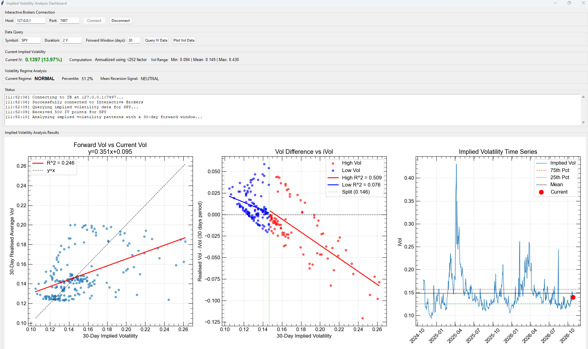

# Volatility Analysis Dashboard

A desktop dashboard for studying **implied volatility (IV) mean reversion** in equities and ETFs. It pulls daily historical implied volatility from Interactive Brokers (IB), classifies the current volatility regime, and runs regressions to show how today's IV relates to the average IV over the following N trading days.

Built with Tkinter, Matplotlib, pandas, and SciPy.



## Features

- **Interactive Brokers integration**: connects to TWS or IB Gateway through the official `ibapi` client and requests daily `OPTION_IMPLIED_VOLATILITY` bars for an equity symbol.
- **Regime classification**: ranks the latest IV against its trailing 252-day window and labels the regime (Low, Below Average, Normal, Above Average, High) with a simple mean-reversion indication.
- **Forward-volatility analysis**: compares current IV with the average IV over a configurable forward window (default 30 days).
- **Regime-split regressions**: splits the data at the point where the overall regression line crosses `y = x`, then fits separate regressions for the high-vol and low-vol regimes.
- **Three linked plots**: forward vs. current vol, vol change vs. ivol (split by regime), and the IV time series with quartile and mean bands.
- **Non-blocking UI**: the IB connection runs on a background thread and the GUI polls for results, so the window stays responsive.

## How it works

1. **Data**: daily IV bars are requested from IB for the chosen symbol and duration. The bar close is used as the implied volatility value.
2. **Percentile**: `iv_percentile` is the rolling 252-observation percentile rank of IV.
3. **Forward vol**: for each day, the mean IV over the next `N` rows of data. The change in vol is `forward_vol - current_vol`.
4. **Overall regression**: `forward_vol ~ current_vol`. The split point is the fixed point of this line, `intercept / (1 - slope)`, which is the long-run IV level the regression implies. If the slope is exactly 1, the median IV is used instead.
5. **Regime regressions**: `vol_diff ~ current_vol` is fitted separately above and below the split point (each requires more than 10 observations). A negative slope in the high-vol regime is consistent with mean reversion.

Regime thresholds on the percentile are: above 80% is High, above 60% is Above Average, above 40% is Normal, above 20% is Below Average, and anything lower is Low.

## Requirements

- Python 3
- Tkinter
- An Interactive Brokers account with **TWS** or **IB Gateway** running and API access enabled
- Python packages:
  - `ibapi`
  - `pandas`
  - `numpy`
  - `scipy`
  - `matplotlib`

## Installation

```bash
git clone https://github.com/JustasDeveikis/VolatilityAnalysisDashboard.git
cd VolatilityAnalysisDashboard

pip install pandas numpy scipy matplotlib ibapi
```

### Enable the IB API

In TWS or IB Gateway, go to **Configure > API > Settings** and:

- Enable **Enable ActiveX and Socket Clients**
- Note the **Socket port** (the dashboard defaults to `7497`)
- Add `127.0.0.1` to the trusted IPs if prompted

Common default ports:

| Application | Paper | Live |
|---|---|---|
| TWS | 7497 | 7496 |
| IB Gateway | 4002 | 4001 |

## Usage

```bash
python main.py
```

1. In **Interactive Brokers Connection**, confirm the host and port, then click **Connect**.
2. In **Data Query**, enter a symbol (default `SPY`), a duration (default `2 Y`), and a forward window in days (default `30`).
3. Click **Query IV Data** to download the IV history. The current IV, its range, and the regime summary update automatically.
4. Click **Plot Vol Data** to run the regressions and draw the three plots.

The duration string follows the IB format, for example `6 M`, `1 Y`, or `2 Y`. Because the percentile uses a 252-observation window, use a duration of **at least 2 years** to get meaningful regime labels; with shorter histories the percentile will be undefined for most of the data.


## Project structure

```
VolatilityAnalysisDashboard/
├── main.py                       # Entry point: builds the Tk window and starts the dashboard
├── classes/
│   ├── ib_app.py                 # IBApp: EWrapper/EClient subclass handling connection and historical data callbacks
│   ├── iv_dashboard.py           # ImpliedVolatilityDashboard: Tkinter UI, IB requests, analysis, and plotting
│   └── volatility_analyzer.py    # VolatilityAnalyzer: IV processing, percentile ranks, regime regressions
└── utils/
    └── mpl_settings.py           # Global Matplotlib style (fonts, tick direction, tick sizes)
```


## Configuration

Most settings are exposed in the GUI. Anything else is set in code:

| Setting | Location | Default |
|---|---|---|
| Host / port | GUI (`iv_dashboard.py`) | `127.0.0.1` / `7497` |
| Symbol, duration, forward window | GUI | `SPY` / `2 Y` / `30` |
| Percentile window | `VolatilityAnalyzer.process_iv` | 252 observations |
| Regime thresholds and colours | `update_regime_analysis` | see above |
| Plot style | `utils/mpl_settings.py` | Arial, inward ticks |
| IB client ID | `_run_ib_connection` | `0` |


